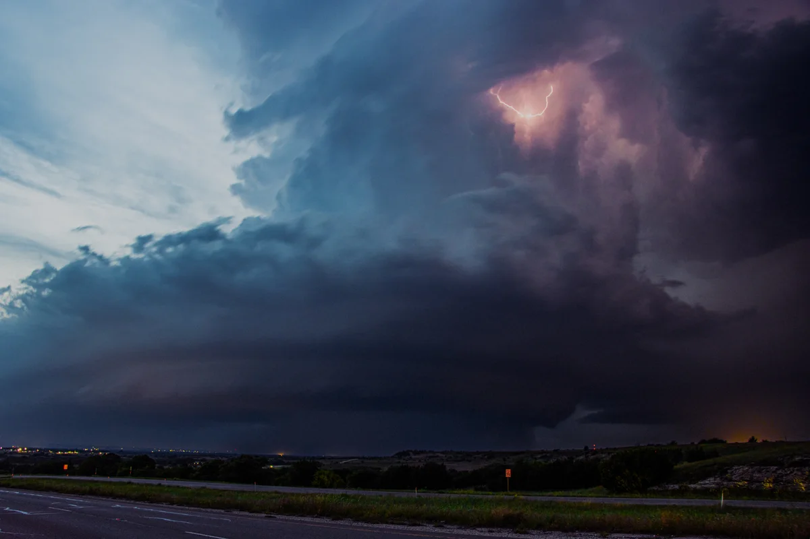

# Supercell Explorer

**Explore airflow. Examine the motion.**

[**Open the live application**](https://supercell.iryna.online/) · [Learn overview](#learn--guided-discovery) · [Run locally](#run-locally) · [Scientific evidence](#scientific-evidence)



*Real storm photograph near Granbury, Texas, 18 May 2025. Photo: [Rollingskyphoto / Wikimedia Commons](https://commons.wikimedia.org/wiki/File:Mesocyclone_and_Associated_Updraft_in_North_Texas.jpg), [CC BY 4.0](https://creativecommons.org/licenses/by/4.0/). Cropped, resized, and converted to WebP for display. This photograph is not an output of Supercell Explorer.*

## Why this project exists

**Supercell Explorer is an interactive kinematic laboratory for inspecting local velocity, its prescribed contributions, and calculated passive tracer paths.** Learn provides prepared Demo comparisons; Explore supports tracer investigations using selected sounding-derived environmental wind profiles or a synthetic Demo environment.

The environmental observations are wind profiles from selected soundings—not observed three-dimensional storm fields. Storm-local updraft, rotation, inflow, outflow and downdraft are prescribed. Results describe this model's behavior within its documented assumptions and qualification limits.

### Who is it for?

- **Weather enthusiasts and curious visitors** who want to see how motion can vary within a three-dimensional flow.
- **Students and educators** exploring trajectories, vectors, reference frames, and the distinction between observation and simulation.
- **Researchers and technically minded users** interested in inspecting model behavior, numerical assumptions, selected diagnostics, and the evidence behind them.
- **Developers** interested in an openly inspectable scientific-software project with documented methods and limitations.

No meteorology background is needed to **begin with Learn**. Understanding and interpreting the deeper laboratory and its scientific results requires more care.

## Choose your path

### Learn — guided discovery

New to airflow models or tracers? **Learn** introduces the ideas step by step, using a simple prescribed Demo flow:

1. **Look Around:** orient yourself in the three-dimensional space and discover why an invisible velocity field needs a way to be observed.
2. **Follow Motion:** watch two passive tracers start at the same height, follow their recorded paths, and compare motion from different starting locations.
3. **Read the Motion:** inspect a tracer's recorded path and local velocity vector at selected moments, and save a reference moment for comparison.
4. **Compare the Flow:** compare velocity vectors and measurements at two stationary probes, repositioning probe B to sample other positions at a fixed model time.

[**Run locally, then choose Learn**](#run-locally)

### Explore — independent investigation

Use the existing laboratory to investigate available environments and prescribed-flow experiments:

- Select **Goshen, Prospect Valley, Dumas, or Moore** sounding-derived environmental wind, or use the synthetic **Demo**.
- Release **passive tracers**, follow their recorded trajectories in 3D, and inspect available motion and vector information along the path.
- For observed environments, change **C**, the *assigned* storm-motion vector, to examine how the storm-relative wind and tracer paths respond. Applying a change starts a new experiment and clears the existing tracer history; Demo keeps its prescribed motion.
- Where data and numerical support permit, inspect **Analysis T1**, a constrained vertical-vorticity tilting diagnostic, and its vector geometry along a recorded trajectory.

The application's **User Guide**, **How It Works**, and **Glossary** explain controls and technical terms in more detail.

[**Open the live application, then choose Explore**](https://supercell.iryna.online/)

## Questions you can investigate

| Research or learning question | Available tool or measurement | Supported interpretation | Scientific limitation |
| --- | --- | --- | --- |
| How does local motion differ between locations? | Learn → Compare the Flow: stationary A/B probes, velocity arrows, speed and components | Spatial differences within the same prescribed field at fixed height and time | Two readings do not establish forces, convergence or real-storm dynamics |
| What velocity does a tracer encounter along its path? | Explore historical Inspector; Learn → Read the Motion timeline and saved reference | Local field values at recorded model positions and times | Calculated paths, not observations of real air parcels or thermodynamic parcel evolution |
| Which prescribed contributions make up local velocity? | Explore → Inspector → Why this motion?: contribution vectors and magnitudes | The model-defined vector decomposition at the selected point | Contributions are not independently observed physical causes; their magnitudes are not additive shares of total speed |
| How do paths differ between starting locations? | Learn → Follow Motion: two prepared passive tracers | Different calculated paths through the same prescribed Demo field | A prepared comparison, not a general ensemble or experiment-comparison system |
| What changes when assigned storm motion C changes? | Explore's observed-environment C editor, hodograph marker and tracer investigations | Behavior of the configured storm-relative prescribed field | C is assigned, not an estimated storm track; interactive exploration does not establish qualified observed Lagrangian C-response |
| How do T1's factors and alignment relate? | Supported Analysis T1 samples, numerical factors and hypothetical alignment | The reduced diagnostic's calculation and alignment dependence | Not full vorticity evolution, parcel spin-up or independent validation |

A hodograph describes how environmental wind varies with height. A tracer provides a moving perspective through the prescribed field. Together with numerical inspection, these views connect where a marker goes with the local model velocity it encounters, without the tracer changing the airflow.

## First exercise: compare motion at fixed height and time

1. Open **Learn → Compare the Flow**.
2. Select **Reset B**.
3. Note the displayed speed and vertical velocity at A and B. Expand **Show horizontal components** to inspect eastward and northward velocity.
4. Press **East · 100 m** five times.
5. Record B's new readings and compare them with its starting readings and the unchanged reference A.
6. Select **Reset B** to return to the starting observation location.

| Observation | East | North | Height above model ground | Model time |
| --- | ---: | ---: | ---: | ---: |
| Fixed probe A | 0 m | −4000 m | 1000 m | 0 s |
| B after Reset B | 2400 m | 0 m | 1000 m | 0 s |
| B after five eastward steps | 2900 m | 0 m | 1000 m | 0 s |

Moving B changes where the field is sampled. The probes are stationary while measured; they are not transported tracers. Differences describe spatial variation within this prescribed field, not time evolution or evidence of real-storm dynamics. Compare the displayed values manually; this exercise requires no export or saved experiment archive.

## Comparison scopes and advanced availability

Learn provides three distinct comparisons: two prepared tracer paths, a selected recorded moment against one saved reference, and two stationary probes in a bounded plane at fixed height/time.

Explore supports tracer release, current and recorded-point inspection, and assigned-C changes for observed environments. It does not provide arbitrary stationary A/B probes or general side-by-side C experiments. Applying a changed C clears existing tracer/history state; the observed ground-relative wind profile and prescribed storm-local fields remain unchanged. Historical inspection samples a recorded position/time; it does not rewind the live tracer.

Analysis T1 is available for supported recorded samples in Goshen, Prospect Valley and Dumas. Its readout distinguishes full filter support from boundary-conditioned support. Moore and Demo have no Analysis representation; out-of-domain or unavailable values are not zero, and Source T1 is not a public fallback. Hypothetical alignment requires a defined alignment and does not modify the field or tracer path. See the [trajectory diagnostic methodology](docs/architecture/62-trajectory-tilting-explorer-v1.md).

## Research direction

**Kinematics first. Thermodynamics next. Coupling only when the physics earns it.**

| Stage | Scope | Status |
| --- | --- | --- |
| **V1 — Kinematics** | Observed environmental profiles, prescribed storm-local flow, passive trajectories, and constrained Analysis T1 | **Implemented**, subject to stated scientific limitations |
| **Next — Thermodynamics** | Atmospheric stability, parcel thermodynamics, buoyancy, CAPE/CIN | **Planned; not implemented** |
| **Later — Expanded experiments** | User-defined scenarios and scientifically defensible coupling of mechanisms | **Longer-term direction; not implemented** |

The [long-term vision](docs/CONCEPT.md) describes additional possibilities, not current capabilities. This roadmap does not imply that a complete atmospheric simulation or a forecasting system is already available.

## What the model actually represents

**Observation:** selected sounding measurements supply environmental horizontal wind as a function of height. Demo uses a synthetic profile.

**Prescription:** the model combines environmental advection with prescribed storm-local fields. Assigned storm motion C sets environmental wind relative to the storm.

**Calculation:** passive tracers are numerically transported through the combined velocity field. They neither change the airflow nor represent full thermodynamic parcels.

**Diagnosis:** local velocity observations and selected diagnostic quantities describe the model. Analysis T1 uses a separate processed environmental representation; it does not replace Source wind for tracer advection or feed back into motion.

| Component | Meaning |
| --- | --- |
| **Environmental wind** | Selected sounding-derived observations, or a prescribed synthetic Demo profile |
| **Storm-local flow** | Prescribed updraft, rotation, inflow, outflow, and downdraft geometry |
| **Storm motion C** | An experiment-assigned eastward/northward vector used to express environmental wind relative to the storm; **not** an estimated or measured storm track |
| **Tracers** | Passive markers transported by the combined prescribed velocity field; **not** full thermodynamic air parcels |
| **T1** | A reduced, explanatory vertical-tilting diagnostic; it does **not** drive tracer motion or represent full vorticity evolution |

**Scientific boundary:** Supercell Explorer is an experimental **kinematic prescribed-flow laboratory**. It does not currently solve thermodynamics, buoyancy, moisture, pressure dynamics, microphysics, or continuity/mass consistency. It is **not** an operational weather forecast, a reconstruction of the historical storms, or a dynamically evolving supercell simulation.

The environmental profile used for tracer motion (**Source**) and the processed representation used for the tilting explanation (**Analysis**) are distinct. Analysis T1 is only available where its data and numerical support requirements are met; unavailable or unsupported does not mean zero.

## Scientific evidence

The September 2026 evidence supports **selected analytical expectations within the prescribed model**, not general physical realism of a complete storm:

- Selected synthetic controls passed their registered analytical checks.
- Observed-profile storm-motion sensitivity identities passed at **fixed points** in the flow (the Eulerian view).
- With the environmental profile and prescribed updraft unchanged, changing assigned storm motion can change a tracer's path while leaving the local fixed-point tilting diagnostic unchanged. Different paths can therefore sample different parts of the same diagnostic geometry.

**An important unresolved qualification:** The first attempt to measure the trajectory response to changing storm motion in observed environments did **not** satisfy required numerical-convergence criteria. It was classified **INVALID CONTROL**—a measurement/numerical-control qualification failure, **not** a physics failure, a null result, or falsification of the response hypothesis. It cannot support a scientific conclusion about that trajectory response.

The V1 usability and scientific-comprehension evaluation was conducted by the author alone. It did not establish independent target-user validation or a formal usability study.

Evidence and methods:

- [Synthetic control protocol and results](docs/research/2026-09-11-storm-motion-sensitivity-and-v1-validation.md)
- [Observed fixed-point findings](docs/research/2026-09-12-observed-c-matrix-protocol-design.md#143-scientific-findings-within-the-frozen-controls)
- [Trajectory campaign outcome and evidence](docs/PROJECT_STATUS.md#phase-p-execution-and-human-closure)
- [T1 derivation](docs/physics/22-diagnostic-tilting-tendency.md) and [trajectory diagnostic methodology](docs/architecture/62-trajectory-tilting-explorer-v1.md)
- [V1 human-evaluation closure](docs/reviews/2026-08-27-v1-closed.md)

**For current scientific gates, permissions, and qualification status, consult [PROJECT_STATUS](docs/PROJECT_STATUS.md).** The [documentation index](docs/README.md) links to the owning methodology and evidence records. A successful software build or test run is not scientific certification.

## Environmental data

These are **selected environmental soundings associated with historical cases**, not observed three-dimensional storm fields.

| Environment | Sounding identity | Time (UTC) | Archive | T1 diagnostic |
| --- | --- | --- | --- | --- |
| Goshen | NSSL1 | 2009-06-05 21:55:22 | EOL 114.114 | Available within supported region |
| Prospect Valley | NSSL1 | 2010-05-26 22:23:46 | EOL 114.114 | Available within supported region |
| Dumas | NSSL2 | 2010-05-18 21:52:18 | EOL 114.114 | Available within supported region |
| Moore | OUN / USM00072357 | 2013-05-20 16:51 (nominal 17 UTC) | NOAA/NCEI IGRA v2.2 | Not available |
| Demo | Prescribed synthetic environment | Not an observed launch | Project-authored profile | Not available |

EOL observations come from NSF NCAR Earth Observing Laboratory's NOAA/NSSL MGAUS Radiosonde Data — EOL Sounding Composite Format, version 1.0, DOI [10.5065/D6CC0Z0Q](https://doi.org/10.5065/D6CC0Z0Q). Moore comes from the Integrated Global Radiosonde Archive, Version 2 (v2.2 files), DOI [10.7289/V5X63K0Q](https://doi.org/10.7289/V5X63K0Q). Its input source code `ncdc6301` identifies NCDC U.S. Rawindsonde Data / DSI-6301, not the IGRA archive's name or license.

Normal runtime uses committed normalized subsets rather than native archive files. See [data attribution and source terms](THIRD_PARTY_NOTICES.md), [EOL source qualification](docs/research/2026-08-28-vortex2-source-qualification.md), [additional case selection](docs/research/2026-08-28-additional-sounding-case-selection.md), and [Moore source qualification](docs/research/2026-08-28-moore-oun-igra-source-qualification.md). Event links in the application provide meteorological context; they are not the source of the sounding data.

## Run locally

Requires **Node.js >=20.19.0** and npm. From a repository checkout:

```sh
npm install
npm run dev
```

Open the local URL printed by Vite.

Developer/software checks and production build:

```sh
npm test
npm run typecheck
npm run build
```

These commands are **not** scientific qualification or a reproduction of campaign conclusions. Scientific campaign entries are separately gated. The npm package is private and unpublished; its package version is separate from the public product release.

## Release and project status

**Latest published product release: V1.1, released/deployed on 2026-09-16.** V1.1 added interactive prescribed storm motion for observed environments. The four-lesson Learn MVP is implemented and checkpointed at `c5a394d0cdf1bbefa7caff0ddf5ed2dba09b955c`. The subsequent Unified UI Shell and Landing polish are implemented and developer-verified, with final integrated human product/UI visual acceptance recorded for the bounded publication. These implementation milestones do not establish a new published release; V1.1 remains the latest established published release until a new release is explicitly authorized and published. These UI developments do not by themselves change scientific validation status. Product publication is separate from scientific validation.

See [PROJECT_STATUS](docs/PROJECT_STATUS.md) for the authoritative current research state and [What's New in the application](https://supercell.iryna.online/) for user-facing changes.

## License, author, and citation

**Author / maintainer: Iryna Hnatovska** · [Professional portfolio](https://iryna.online)

Iryna-owned Supercell Explorer code is source publicly available under [PolyForm Noncommercial 1.0.0](LICENSE.md). Commercial use of that code requires separate permission/license from Iryna Hnatovska where not permitted by the public license; use the portfolio above for contact. The license's own permitted purposes and organizational provisions apply without additional restrictions.

**Required Notice:** Copyright 2026 Iryna Hnatovska.

External observations, dependencies, upstream adaptations, photographs, and other third-party materials retain their own terms and are **not** covered by the project-code license. See [THIRD_PARTY_NOTICES](THIRD_PARTY_NOTICES.md) for scope and attribution, including the logo's generated provenance. The hero photograph is credited separately above under **CC BY 4.0**.

Use [CITATION.cff](CITATION.cff) to cite Supercell Explorer. Cite source datasets separately when using their observations; software citation does not replace data attribution.

## Further reading

Start with [PROJECT_STATUS](docs/PROJECT_STATUS.md), the [documentation index](docs/README.md), [physics definitions](docs/physics/), or [software architecture](docs/ARCHITECTURE.md). [Known limitations](docs/KNOWN_LIMITATIONS.md) preserves the historical V1 baseline with scope clarifications. [Long-term vision](docs/CONCEPT.md) describes future concepts, not implemented capabilities.

*For the full interactive 3D laboratory, a desktop browser is recommended.*