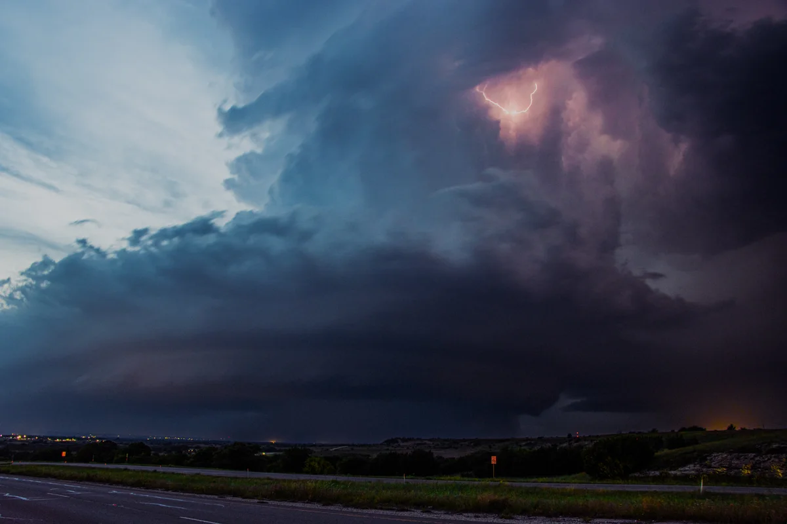

# Supercell Explorer

**Explore the physics of atmospheric motion.**

[**Open the live application**](https://supercell.iryna.online/) · [Learn overview](#learn--guided-discovery) · [Run locally](#run-locally) · [Scientific evidence](#scientific-evidence)



*Real storm photograph near Granbury, Texas, 18 May 2025. Photo: [Rollingskyphoto / Wikimedia Commons](https://commons.wikimedia.org/wiki/File:Mesocyclone_and_Associated_Updraft_in_North_Texas.jpg), [CC BY 4.0](https://creativecommons.org/licenses/by/4.0/). Cropped, resized, and converted to WebP for display. This photograph is not an output of Supercell Explorer.*

## Why this project exists

What happens to airflow inside a supercell thunderstorm? How does motion change across three-dimensional space? And what can we learn by following movement through a calculated flow rather than looking at conditions at one fixed location?

**Supercell Explorer is an interactive computational laboratory for investigating these questions.** It brings together atmospheric observations, prescribed three-dimensional flow, passive tracer trajectories, numerical methods, and inspection tools. The aim is to make complex patterns of motion visible **and examinable**—while being explicit about what the model represents, what has been tested, and what remains uncertain.

It began with a simple curiosity: *what would it be like to move through a supercell and examine the physics along the way?* The current prototype is a first, deliberately constrained step toward that larger research vision.

### Who is it for?

- **Weather enthusiasts and curious visitors** who want to see how motion can vary within a three-dimensional flow.
- **Students and educators** exploring trajectories, vectors, reference frames, and the distinction between observation and simulation.
- **Researchers and technically minded users** interested in inspecting model behavior, numerical assumptions, selected diagnostics, and the evidence behind them.
- **Developers** interested in an openly inspectable scientific-software project with documented methods and limitations.

No meteorology background is needed to **begin with Learn**. Understanding and interpreting the deeper laboratory and its scientific results requires more care.

## Choose your path

### Learn — guided discovery

New to airflow models or tracers? **Learn** introduces the ideas step by step, using a simple prescribed Demo flow:

1. **Look Around:** orient yourself in the three-dimensional space and discover why an invisible velocity field needs a way to be observed.
2. **Follow Motion:** watch two passive tracers start at the same height, follow their recorded paths, and compare motion from different starting locations.
3. **Read the Motion:** inspect a tracer's recorded path and local velocity vector at selected moments, and save a reference moment for comparison.
4. **Compare the Flow:** compare velocity vectors and measurements at two stationary probes, repositioning probe B to sample other positions at a fixed model time.

[**Run locally, then choose Learn**](#run-locally)

### Explore — independent investigation

Use the existing laboratory to investigate available environments and prescribed-flow experiments:

- Select **Goshen, Prospect Valley, Dumas, or Moore** sounding-derived environmental wind, or use the synthetic **Demo**.
- Release **passive tracers**, follow their recorded trajectories in 3D, and inspect available motion and vector information along the path.
- For observed environments, change **C**, the *assigned* storm-motion vector, to examine how the storm-relative wind and tracer paths respond. Applying a change starts a new experiment and clears the existing tracer history; Demo keeps its prescribed motion.
- Where data and numerical support permit, inspect **Analysis T1**, a constrained vertical-vorticity tilting diagnostic, and its vector geometry along a recorded trajectory.

The application's **User Guide**, **How It Works**, and **Glossary** explain controls and technical terms in more detail.

[**Open the live application, then choose Explore**](https://supercell.iryna.online/)

## More than a visualization

| Scientific data | Motion and vectors | Controlled experiments |
| --- | --- | --- |
| Selected sounding-derived environmental profiles with documented provenance | Three-dimensional passive tracer trajectories, sampled velocities, and supported diagnostics | Prescribed flow geometry, explicit parameters, numerical procedures, and recorded checks |

A key research question is: **how does following a moving tracer change what we observe compared with sampling the flow at a fixed point?** A hodograph describes how environmental wind varies with height; a tracer offers a moving perspective through the prescribed flow. Tracers reveal the model's motion without changing the velocity field themselves.

## Research direction

**Kinematics first. Thermodynamics next. Coupling only when the physics earns it.**

| Stage | Scope | Status |
| --- | --- | --- |
| **V1 — Kinematics** | Observed environmental profiles, prescribed storm-local flow, passive trajectories, and constrained Analysis T1 | **Implemented**, subject to stated scientific limitations |
| **Next — Thermodynamics** | Atmospheric stability, parcel thermodynamics, buoyancy, CAPE/CIN | **Planned; not implemented** |
| **Later — Expanded experiments** | User-defined scenarios and scientifically defensible coupling of mechanisms | **Longer-term direction; not implemented** |

The [long-term vision](docs/CONCEPT.md) describes additional possibilities, not current capabilities. This roadmap does not imply that a complete atmospheric simulation or a forecasting system is already available.

## What the model actually represents

| Component | Meaning |
| --- | --- |
| **Environmental wind** | Selected sounding-derived observations, or a prescribed synthetic Demo profile |
| **Storm-local flow** | Prescribed updraft, rotation, inflow, outflow, and downdraft geometry |
| **Storm motion C** | An experiment-assigned eastward/northward vector used to express environmental wind relative to the storm; **not** an estimated or measured storm track |
| **Tracers** | Passive markers transported by the combined prescribed velocity field; **not** full thermodynamic air parcels |
| **T1** | A reduced, explanatory vertical-tilting diagnostic; it does **not** drive tracer motion or represent full vorticity evolution |

**Scientific boundary:** Supercell Explorer is an experimental **kinematic prescribed-flow laboratory**. It does not currently solve thermodynamics, buoyancy, moisture, pressure dynamics, microphysics, or continuity/mass consistency. It is **not** an operational weather forecast, a reconstruction of the historical storms, or a dynamically evolving supercell simulation.

The environmental profile used for tracer motion (**Source**) and the processed representation used for the tilting explanation (**Analysis**) are distinct. Analysis T1 is only available where its data and numerical support requirements are met; unavailable or unsupported does not mean zero.

## Scientific evidence

The September 2026 evidence supports **selected analytical expectations within the prescribed model**, not general physical realism of a complete storm:

- Selected synthetic controls passed their registered analytical checks.
- Observed-profile storm-motion sensitivity identities passed at **fixed points** in the flow (the Eulerian view).
- With the environmental profile and prescribed updraft unchanged, changing assigned storm motion can change a tracer's path while leaving the local fixed-point tilting diagnostic unchanged. Different paths can therefore sample different parts of the same diagnostic geometry.

**An important unresolved qualification:** The first attempt to measure the trajectory response to changing storm motion in observed environments did **not** satisfy required numerical-convergence criteria. It was classified **INVALID CONTROL**—a measurement/numerical-control qualification failure, **not** a physics failure, a null result, or falsification of the response hypothesis. It cannot support a scientific conclusion about that trajectory response.

The V1 usability and scientific-comprehension evaluation was conducted by the author alone. It did not establish independent target-user validation or a formal usability study.

Evidence and methods:

- [Synthetic control protocol and results](docs/research/2026-09-11-storm-motion-sensitivity-and-v1-validation.md)
- [Observed fixed-point findings](docs/research/2026-09-12-observed-c-matrix-protocol-design.md#143-scientific-findings-within-the-frozen-controls)
- [Trajectory campaign outcome and evidence](docs/PROJECT_STATUS.md#phase-p-execution-and-human-closure)
- [T1 derivation](docs/physics/22-diagnostic-tilting-tendency.md) and [trajectory diagnostic methodology](docs/architecture/62-trajectory-tilting-explorer-v1.md)
- [V1 human-evaluation closure](docs/reviews/2026-08-27-v1-closed.md)

**For current scientific gates, permissions, and qualification status, consult [PROJECT_STATUS](docs/PROJECT_STATUS.md).** The [documentation index](docs/README.md) links to the owning methodology and evidence records. A successful software build or test run is not scientific certification.

## Environmental data

These are **selected environmental soundings associated with historical cases**, not observed three-dimensional storm fields.

| Environment | Sounding identity | Time (UTC) | Archive | T1 diagnostic |
| --- | --- | --- | --- | --- |
| Goshen | NSSL1 | 2009-06-05 21:55:22 | EOL 114.114 | Available within supported region |
| Prospect Valley | NSSL1 | 2010-05-26 22:23:46 | EOL 114.114 | Available within supported region |
| Dumas | NSSL2 | 2010-05-18 21:52:18 | EOL 114.114 | Available within supported region |
| Moore | OUN / USM00072357 | 2013-05-20 16:51 (nominal 17 UTC) | NOAA/NCEI IGRA v2.2 | Not available |
| Demo | Prescribed synthetic environment | Not an observed launch | Project-authored profile | Not available |

EOL observations come from NSF NCAR Earth Observing Laboratory's NOAA/NSSL MGAUS Radiosonde Data — EOL Sounding Composite Format, version 1.0, DOI [10.5065/D6CC0Z0Q](https://doi.org/10.5065/D6CC0Z0Q). Moore comes from the Integrated Global Radiosonde Archive, Version 2 (v2.2 files), DOI [10.7289/V5X63K0Q](https://doi.org/10.7289/V5X63K0Q). Its input source code `ncdc6301` identifies NCDC U.S. Rawindsonde Data / DSI-6301, not the IGRA archive's name or license.

Normal runtime uses committed normalized subsets rather than native archive files. See [data attribution and source terms](THIRD_PARTY_NOTICES.md), [EOL source qualification](docs/research/2026-08-28-vortex2-source-qualification.md), [additional case selection](docs/research/2026-08-28-additional-sounding-case-selection.md), and [Moore source qualification](docs/research/2026-08-28-moore-oun-igra-source-qualification.md). Event links in the application provide meteorological context; they are not the source of the sounding data.

## Run locally

Requires **Node.js >=20.19.0** and npm. From a repository checkout:

```sh
npm install
npm run dev
```

Open the local URL printed by Vite.

Developer/software checks and production build:

```sh
npm test
npm run typecheck
npm run build
```

These commands are **not** scientific qualification or a reproduction of campaign conclusions. Scientific campaign entries are separately gated. The npm package is private and unpublished; its package version is separate from the public product release.

## Release and project status

**Latest published product release: V1.1, released/deployed on 2026-09-16.** V1.1 added interactive prescribed storm motion for observed environments. The four-lesson Learn MVP is implemented and checkpointed at `c5a394d0cdf1bbefa7caff0ddf5ed2dba09b955c`. The subsequent Unified UI Shell and Landing polish are implemented and developer-verified, with final integrated human product/UI visual acceptance recorded for the bounded publication. These implementation milestones do not establish a new published release; V1.1 remains the latest established published release until a new release is explicitly authorized and published. These UI developments do not by themselves change scientific validation status. Product publication is separate from scientific validation.

See [PROJECT_STATUS](docs/PROJECT_STATUS.md) for the authoritative current research state and [What's New in the application](https://supercell.iryna.online/) for user-facing changes.

## License, author, and citation

**Author / maintainer: Iryna Hnatovska** · [Professional portfolio](https://iryna.online)

Iryna-owned Supercell Explorer code is source publicly available under [PolyForm Noncommercial 1.0.0](LICENSE.md). Commercial use of that code requires separate permission/license from Iryna Hnatovska where not permitted by the public license; use the portfolio above for contact. The license's own permitted purposes and organizational provisions apply without additional restrictions.

**Required Notice:** Copyright 2026 Iryna Hnatovska.

External observations, dependencies, upstream adaptations, photographs, and other third-party materials retain their own terms and are **not** covered by the project-code license. See [THIRD_PARTY_NOTICES](THIRD_PARTY_NOTICES.md) for scope and attribution, including the logo's generated provenance. The hero photograph is credited separately above under **CC BY 4.0**.

Use [CITATION.cff](CITATION.cff) to cite Supercell Explorer. Cite source datasets separately when using their observations; software citation does not replace data attribution.

## Further reading

Start with [PROJECT_STATUS](docs/PROJECT_STATUS.md), the [documentation index](docs/README.md), [physics definitions](docs/physics/), or [software architecture](docs/ARCHITECTURE.md). [Known limitations](docs/KNOWN_LIMITATIONS.md) preserves the historical V1 baseline with scope clarifications. [Long-term vision](docs/CONCEPT.md) describes future concepts, not implemented capabilities.

*For the full interactive 3D laboratory, a desktop browser is recommended.*